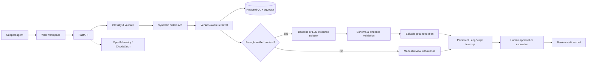

# SupportOps AI

A working, evidence-grounded support workspace for a fictional online store. An agent receives a customer request, checks the order, sees the relevant policy, edits a draft and approves it—or hands the request to a person with an explicit reason.

**No replies, cancellations or refunds are executed automatically.** All store records are synthetic. The default mode runs without an LLM key or an AWS account.


## Start locally

Requires Python 3.11+ (3.13 recommended). Node is only needed for optional formatting or JavaScript syntax checks.

```bash
git clone https://github.com/dkkdark/SupportOps-AI.git
cd SupportOps-AI
python3.13 -m venv .venv
source .venv/bin/activate
pip install -r requirements.lock
pip install --no-deps -e .
cp .env.example .env
python -m scripts.dev
```

Open **http://127.0.0.1:8010**. OpenAPI documentation is at **http://127.0.0.1:8010/docs**. The mock orders API runs at **http://127.0.0.1:8001/docs**. `Ctrl+C` stops both processes. Local state is stored under the ignored `var/` directory.

Start with the first ticket, **“Where is my order? Can I cancel?”**, and select **Prepare a reply**. The result should include the real synthetic API status, tracking number, the current delay policy and the rule against cancelling a dispatched order. Inspect **Sources** and **Workflow**, edit the reply and select **Approve reply**. Approval records a decision; copying and sending the reply remain separate actions.

```bash
make test       # API, business rules, failures, persistence and review
make eval       # 80 development cases, then 20 holdout cases
make smoke      # health → create → analyze → sources → idempotency → approve
```

For the existing local checkout, `make dev` is enough after installation. Existing Russian preview data, if present from the initial implementation, was preserved under `var/backups/`; the active demo is English.

## Run PostgreSQL + pgvector with Docker

```bash
docker compose up --build -d
docker compose ps
docker compose logs -f app
# http://127.0.0.1:8010
docker compose down
```

Compose starts PostgreSQL 17 with pgvector, runs Alembic, starts the synthetic orders API and starts the application. The database has no host port. Application access is bound to loopback. The named `postgres` volume preserves tickets and checkpoints across restarts. **`docker compose down -v` removes that local database**; omit `-v` to preserve it. Stop the Python preview before using Compose on port 8010.

The Compose password is a public, local-only demonstration credential. Cloud credentials are supplied by Secrets Manager. See [deployment](docs/deployment.md) for AWS and Kubernetes.

## What is implemented

| Area | Behavior |
| --- | --- |
| Workspace | Responsive English UI, queue/search/status filters, priorities, order and customer context |
| Drafts | Editable response, evidence citations, source version and effective date, original-draft checks |
| Human review | Approve or escalate, revision conflict detection, immutable review records, persisted workflow resume |
| API | FastAPI + Pydantic validation, idempotency keys, ownership and order-number checks |
| Workflow | LangGraph nodes for classification, API lookup, retrieval, generation, validation and interrupt/resume |
| Storage | SQLAlchemy + Alembic; SQLite for quick start, PostgreSQL + pgvector for Compose/cloud |
| Retrieval | 12 current rule chunks + 1 archived version; effective-date filtering, conflict detection, hybrid ranking |
| Evaluation | 100 labeled English cases, separate dev/holdout wording, factual assertions, macro-F1, escalation recall, latency and LLM usage |
| Operations | Per-ticket trace IDs, OpenTelemetry spans/metrics, structured step logs, fault scenarios and recovery |
| Delivery | GitHub Actions tests/integration/evaluation/build; manually dispatched OIDC staging deployment and rollback |
| Infrastructure | Terraform for VPC, ALB/HTTPS, ECS Fargate, ECR, RDS, S3, Secrets Manager, CloudWatch, SNS and scoped IAM |
| Kubernetes | Optional Helm chart, external PostgreSQL, migration hook, probes, resources and rolling updates |

## The workflow



Details and deliberate tradeoffs: [architecture](docs/architecture.md).

## Models and retrieval

`MODEL_PROVIDER=baseline` is deterministic and does **not** call an LLM. The optional `openai_compatible` provider calls a configurable Chat Completions-compatible HTTP endpoint. Set `LLM_MODEL`, `LLM_BASE_URL` and `LLM_API_KEY` in `.env`; restart the application. No provider credentials are sent to the frontend.

The model selects **fact IDs and tone**, rather than writing unconstrained factual claims. Pydantic validates its response; trusted code composes the final wording from the order API and approved policy facts. Missing/unsupported facts trigger at most two attempts, then a manual handoff. This intentionally trades flexible prose for a stricter grounding contract. Classification is a transparent English/Russian keyword baseline, not a claimed trained classifier. Return eligibility reads the day window from the selected current policy fact; it does not substitute the archived window.

Embeddings use a versioned **128-dimensional character-hash baseline** that runs offline. This is not a pretrained semantic model. PostgreSQL uses actual pgvector cosine ordering with lexical/category ranking; SQLite computes the same vector ordering in Python. The corpus contains short, manually bounded rule chunks, each with its own source/version metadata. A production semantic embedding model would need a new embedding version, reindexing and a separately measured benchmark.

## Evaluation and release evidence

```bash
python -m eval.run --split dev --output reports/dev.json
python -m eval.run --split holdout
# Optional, billable external model calls; requires explicit LLM configuration:
python -m eval.run --split holdout --live --output reports/live.json
```

The UI reads `reports/evaluation.json`; it never manufactures a quality score. Reports retain code, prompt, model, policy, embedding and dataset versions, the dataset hash, individual case outcomes, token counts, cost estimate, p50/p95 and thresholds. Default runs use controlled order fixtures and no external model. Reported latency is **sequential evaluation latency**, not an AWS capacity benchmark. The holdout set is separate wording for the same 20 scenario families, not an independently sampled production distribution. Do not tune a release against its final holdout; create a new dataset version for subsequent development.

The release gate requires every case to pass. Factual correctness here means the defined schema/fact/source checks; it is not a broad natural-language semantic evaluation. Time saved for agents and agreement with human evaluators have not been measured. See [evaluation](docs/evaluation.md).

LLM pricing defaults to zero because no provider/model is assumed. Before a live run, set `MODEL_INPUT_USD_PER_MILLION` and `MODEL_OUTPUT_USD_PER_MILLION` to your actual rates. Token counts remain useful without prices. Infrastructure charges are separate and are not estimated by the UI.

## Failures and recovery

In local development, **Monitoring → Test failure handling** creates a separate synthetic ticket for API timeout, invalid model output or missing sources. Restore normal behavior with **Retry analysis**. Approved/escalated tickets cannot be analyzed again. In production, fault injection is disabled unless explicitly enabled.

The full [runbook](docs/runbook.md) covers timeouts, malformed output, stuck processing, bad releases, rollback and database recovery.

## Standalone demo

```bash
make demo
# http://127.0.0.1:8011
```

`scripts/build_demo.py` exports the same UI and an explicitly labeled browser simulation into `demo/dist`. It uses localStorage, has no backend or live model, and shows no invented processing timings. Its evaluation panel is a snapshot of the local report. It is useful for a portfolio walkthrough, not for shared or durable records.

## Verification limits

The Python application, workflow, failure cases, restart persistence, evaluation and browser interactions have been checked locally. Terraform has been initialized and validated; Helm has been rendered and checked; Compose configuration has been validated. The current machine’s Docker daemon is not running, so **the container build and real PostgreSQL/pgvector integration have not been executed locally**. CI includes both checks. AWS, an external model and a Kubernetes cluster have not been deployed or benchmarked.

This is an executable portfolio project, not a production multitenant helpdesk. It uses a shared API key when configured; SSO, per-agent authorization, real store ownership verification, production migrations/role separation, PII retention and a transactional outbound action system require additional work before processing real customer data.

The GitHub remote is configured, but **nothing has been pushed**. All features are recorded as local commits.

## Reference documentation

- [FastAPI lifespan](https://fastapi.tiangolo.com/advanced/events/)
- [LangGraph persistence](https://docs.langchain.com/oss/python/langgraph/persistence)
- [pgvector Python / SQLAlchemy](https://github.com/pgvector/pgvector-python)
- [RDS PostgreSQL extension versions](https://docs.aws.amazon.com/AmazonRDS/latest/PostgreSQLReleaseNotes/postgresql-extensions.html)
- [ECS deployment failure detection](https://docs.aws.amazon.com/AmazonECS/latest/developerguide/deployment-failure-detection.html)
