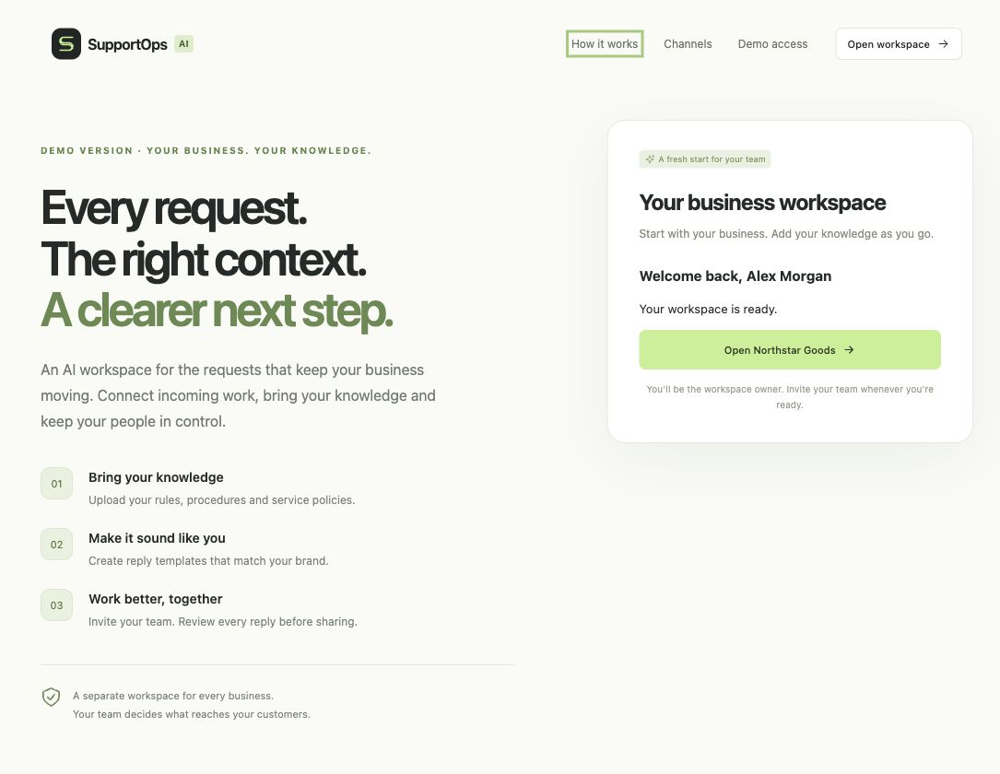
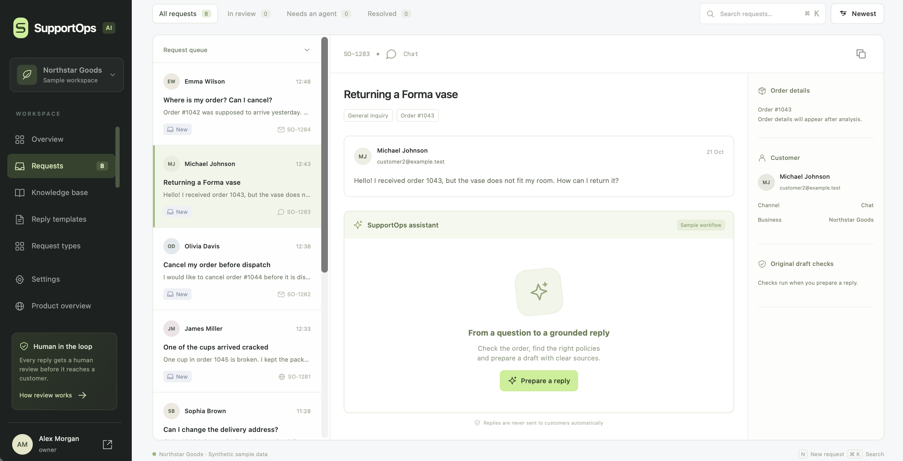

# SupportOps AI

A multi-tenant AI platform for business requests across operations, sales, internal services, IT and customer-facing teams. Each business has an isolated workspace with its own knowledge, employees, request types and response templates.

## Core capabilities

- Business registration, owner/admin/agent roles and employee invitations.
- Shared request queues with types, assignments, search, filters and review history.
- Hosted public forms, scoped inbound API connections and internal employee requests.
- Versioned business policies imported from PDF, DOCX, TXT, Markdown and JSON.
- An OpenAI agent with read-only investigation tools, semantic retrieval and source citations.
- Independent grounding verification followed by human editing, approval or escalation.
- Durable indexing and account-email jobs with retries and worker health checks.
- Per-account AI spending limits, atomic reservations and usage accounting.

## Agent and retrieval

| Component | Implementation |
| --- | --- |
| Agent | OpenAI Responses API with a bounded tool-calling loop |
| Default agent and verifier | `gpt-5.4-mini`, with a separate verification call |
| Embeddings | `text-embedding-3-large`, 1,536 dimensions |
| Vector search | Qdrant with workspace/profile filters and SQL evidence revalidation |
| Ranking | Cosine similarity, lexical ranking and maximal marginal relevance |
| Human review | Persistent LangGraph interrupt/resume and revision checks |
| Business records | SQLAlchemy with SQLite locally and PostgreSQL in server configurations |

The agent searches policies, reads source passages, inspects request types/templates and requests human handoff. Tools cannot choose another tenant, execute arbitrary code, send customer replies, issue payments or modify external records. Unsupported citations, failed verification, provider errors and exceeded budgets prevent an approvable draft.

Source versions, effective dates, archive state and workspace boundaries are checked before evidence reaches the agent. Approval records the employee's decision and final text; replies are not delivered automatically.

## Request channels

Hosted forms create requests in the associated business queue. Inbound API credentials allow request creation only, are stored hashed and support revocation. Connection-scoped external IDs deduplicate imports. Employees can also create and route requests internally.

Native mailbox/messenger synchronization, incoming-request attachments and automatic outbound delivery are outside the current implementation. Knowledge-document uploads are supported separately.

## Demo and cost control

The current demo hides paid plans and disables payment endpoints. Each user account has a one-time **$5 AI allowance** across all workspaces. Paid indexing, query embeddings, agent calls and verification share this allowance. Atomic reservations protect against concurrent overspending; uncertain provider charges retain their reserve until reconciliation.

Manual request handling, team management, templates and access to stored knowledge remain available after the allowance is exhausted. Purchasing-launch notification requests are recorded without automatically sending announcements.

## Infrastructure

The repository includes Docker, Compose, Terraform, Helm and CI/CD configurations. The AWS blueprint covers ECS Fargate, ECR, ALB, RDS, Secrets Manager, S3 and CloudWatch. Qdrant is a separate persistent vector service. Infrastructure definitions describe the intended deployment architecture; they do not establish a running cloud environment.

## Quality and testing

The project includes backend and frontend regression tests covering tenant isolation, authentication, agent tool calls, grounding verification, usage limits, intake deduplication, worker recovery and interface behavior. Integration coverage includes real PostgreSQL and Qdrant with controlled model responses. Browser checks cover desktop and mobile layouts.

The synthetic retail evaluation is a regression benchmark; it does not measure accuracy on arbitrary business data. Human approval remains part of the request workflow.

Technical details: [architecture](docs/architecture.md), [testing](docs/testing.md), [evaluation](docs/evaluation.md), [subscription economics](docs/unit-economics.md).
